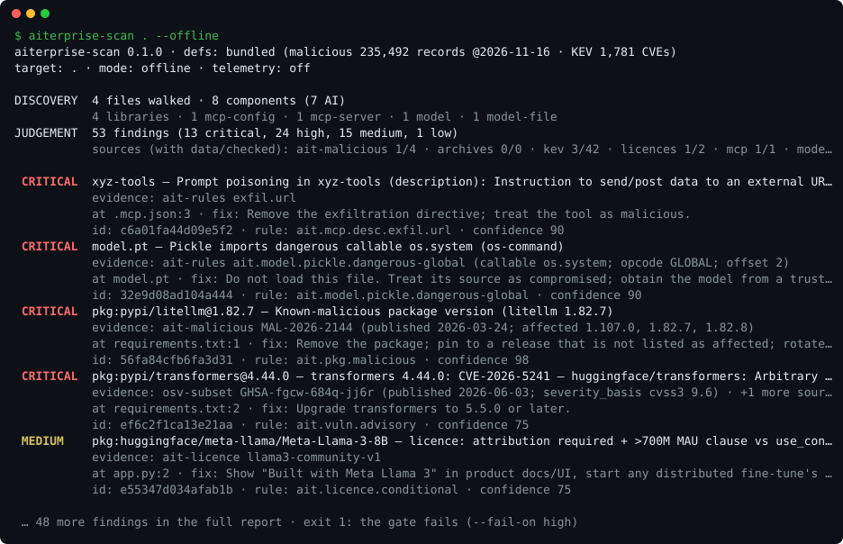

# AIterprise AIBOM Scanner — `aiterprise-scan`

<!-- mcp-name: io.github.jtopaz1/aiterprise-scan -->

The open-source AI supply-chain scanner you can run offline: an AI-BOM with teeth. One command walks
a repository, a model file, a package archive, an agent configuration or a third-party AI-BOM,
inventories every AI component, and judges it — every finding carries its evidence, what was
consulted to reach it, and the rule's measured false-positive rate where one exists.

```bash
pipx install aiterprise-scan        # or: pip install .   · or a single-file binary from Releases
aiterprise-scan .                   # scan the current repository
aiterprise-scan ui                  # local web UI: history, findings, diff, suppressions
```

> **Not released yet.** Nothing is published so far: `pipx install aiterprise-scan`, the binaries and
> the container image arrive with the first tagged release ([RELEASING.md](RELEASING.md)). Until then,
> install from a checkout with `pip install .`.

Apache-2.0 · zero runtime dependencies (standard library only) · Python 3.11+ · docs in [`docs/`](docs/index.md)



*One offline scan of a four-file repository with five planted problems, all found
([`tools/killer_demo.py`](tools/killer_demo.py)); an excerpt of the table report.*

## What it finds

| Area | What is judged | Rule ids |
|---|---|---|
| Packages | Known-malicious versions (OSV `MAL-` snapshot; withdrawn records reported as `withdrawn`, never active); ranges that admit a malicious version; names that do not exist on PyPI/npm (slopsquatting), packages published in the last 72 h, npm security holders, typosquats of popular and AI packages; a recent release after years of silence or with a sudden major-version jump, or one that dropped its provenance or came from a new publisher | `ait.pkg.*` |
| Vulnerabilities | OSV advisories per exact version, alias-deduplicated, fix versions; CISA KEV upgrades to critical; a bundled AI-package advisory subset keeps this working offline and during OSV outages | `ait.vuln.*` |
| Model files | Pickle opcodes (raw and zip-wrapped, protocol 0–5) with dangerous callables, safetensors/GGUF/ONNX/HDF5/Keras/TFLite inventory, Keras `Lambda`, ONNX custom ops, GGUF chat-template injection, malformed containers; files that incident reports name, by SHA-256 or SHA-1 (offline), and SecDB's known-bad hashes when logged in | `ait.model.*` |
| Package archives | Wheels, sdists, tarballs, eggs: `.pth` start-up payloads, `setup.py` and npm lifecycle commands, path traversal, model files inside | `ait.archive.*` |
| MCP servers | Every agent's config (Claude Desktop/Code, Cursor, VS Code, Codex, Windsurf, Gemini, OpenClaw, DeepSeek Harness) and MCPB/DXT bundles: dangerous commands (57 rules), poisoned descriptions (20 patterns: hidden directives, forged chat turns, exfiltration through URLs, images and tool arguments, credential reads, homoglyphs), literal secrets, scope — **without launching anything**; SecDB reputation when logged in | `ait.mcp.*` |
| Agent skills | `SKILL.md` trees, Claude Code plugins/commands: instruction poisoning, install-script commands, risk score — in a project, and with `--agent-configs` in the skills folders of the machine (Claude Code, Codex, OpenClaw, `~/.agents/skills`) | `ait.skill.*` |
| Licences | Model and dataset licence verdicts (Llama, Gemma, OpenRAIL, Mistral, Qwen, DBRX, DeepSeek, Falcon, CC-BY-NC, …) against your `use_context` — advisory, not legal advice; written into the AI-BOM's `licenses[]` | `ait.licence.*` |
| Secrets | AI-provider keys in configs and code, reported redacted | `ait.secret.*` |
| Prompts, endpoints, vector stores | Listed in the AI-BOM, not judged: agent instruction files (`AGENTS.md`, `CLAUDE.md`, `.cursorrules`, Copilot and Cursor rules, …), sub-agents and their tool grants, prompt templates and hub prompts; the AI APIs the code calls (provider URLs, `OPENAI_BASE_URL` and other endpoint variables, a client's `base_url`); vector stores (Chroma, Qdrant, Milvus, Weaviate, pgvector, LanceDB, FAISS, Pinecone). The text of a prompt is never copied, and credentials are cut from URLs | — |
| Third-party (your own key) | `--byo virustotal=ENV_VAR`: VirusTotal's verdict on model files and package archives, by SHA-256 only — labelled VirusTotal, never uploaded, cached, sent to SecDB or merged into AIterprise data ([docs](docs/providers.md)) | `ext.virustotal.*` |

Inputs: `requirements*.txt`, `pyproject.toml` (PEP 621 + Poetry), `Pipfile(.lock)`, `poetry.lock`,
`uv.lock`, `environment.yml`, `package.json`, `package-lock.json` v1–v3, `pnpm-lock.yaml`,
`yarn.lock`; Python/JS imports and notebooks; `.whl`/`.tar.gz`/`.egg`/`.mcpb`/`.dxt` archives;
CycloneDX 1.4–1.7 and SPDX JSON BOMs (cdxgen, Snyk, OWASP generators). A lockfile always wins over
a manifest, and a range is never treated as an exact version.

## Usage

```bash
aiterprise-scan .                                   # table report on stdout, exit 0/1/2
aiterprise-scan . --offline                         # bundled definitions + cache only, no network
aiterprise-scan scan --bom cdxgen-aibom.json        # judge someone else's AI-BOM
aiterprise-scan scan dist/mypkg-1.0-py3-none-any.whl  # judge a package before you publish or install it
aiterprise-scan . --format sarif --out reports/     # report.sarif for GitHub code scanning
aiterprise-scan . --emit-bom aibom.cdx.json         # CycloneDX 1.7 AI-BOM: findings, licence verdicts, modelCard
aiterprise-scan . --save                            # keep the scan in the local history (`ui`)
aiterprise-scan mcp --agent-configs                 # this machine's MCP servers and skills
aiterprise-scan bom . --out aibom.cdx.json          # inventory only (fast compliance mode)
aiterprise-scan . --write-baseline .aiterprise/baseline.json   # adopt gating without fixing everything
aiterprise-scan ui                                  # local web UI on 127.0.0.1
aiterprise-scan policy lint aibom.policy.yaml
aiterprise-scan policy pull --cloud https://aibom.example.com   # the org policy from an AIterprise cloud
aiterprise-scan defs status | verify | install | update | rollback   # signed definition bundles
aiterprise-scan . --defs-version rel_…              # pin an installed definitions release for a repeatable audit
```

Exit codes: `0` clean · `1` policy failure (`--fail-on`, default `high`) · `2` error or incomplete
scan (an analyzer failed, or a source such as OSV could not be reached; `--offline` is not an error).
Files the scanner had to skip are reported as `ait.*.not-analysable` findings, never passed as clean.

## SecDB (optional)

Logged in, the scanner also asks [SecDB](https://secdb.aiterprise.net) about model-file hashes,
private MCP URLs (by an 8-hex SHA-256 prefix only — the URL never leaves the machine) and packages.

```bash
aiterprise-scan login                   # paste an API key (aik_…); checked with /v1/me before it is saved
aiterprise-scan status                  # plan, per-minute limit, usage this month
aiterprise-scan . --upload              # send the JSON report (SecDB Pro+, or --cloud URL); local paths stripped
aiterprise-scan report-fp ait.mcp.cmd.pipe-to-shell --notes "…"   # with your consent
aiterprise-scan logout
```

In CI set `AITERPRISE_API_KEY` from a secret. Limits come from your plan (`/v1/me`): when the
per-minute budget or quota runs out, the rest is reported **UNVERIFIED, not safe** — never as clean.
`--offline` and `--no-secdb` never call SecDB.

## Policy

`aibom.policy.yaml` in the scanned directory (or `--policy FILE`):

```yaml
version: 1
use_context: commercial          # commercial | internal | research | non-profit
fail_on: [critical, high]
ignore:
  - rule: ait.pkg.malicious-unpinned
    paths: ["experiments/**"]
allow_packages: ["pkg:pypi/openai@>=1.40"]
deny_packages: ["pkg:pypi/litellm@1.82.7"]
deny_model_licences: [cc-by-nc-4.0]
suppressions:                    # expiry is mandatory
  - finding: 1a2b3c4d5e6f7a8b    # fingerprint, advisory id or rule id
    until: 2027-06-30
    reason: vendor patch scheduled
    approved_by: security@company
baseline: .aiterprise/baseline.json
```

Suppressions made in the UI go to `.aiterprise/suppressions.json` (same rules: a reason, and an
expiry at most 365 days ahead); commit it so CI applies them. A known-malicious finding (verdict
`malicious`) is never silenced by `ignore`, `allow_packages`, a rule-, path- or advisory-wide
suppression, or a baseline; only an expiring suppression that names its fingerprint accepts it.
`.snyk` ignore files can be imported with `--snyk .snyk` (30-day default expiry).

## CI

GitHub Action (comments the findings on the pull request, writes the job summary, uploads SARIF, then gates):

```yaml
on: pull_request
permissions:
  contents: read
  pull-requests: write          # the pull-request comment
  security-events: write        # the SARIF upload
jobs:
  aibom:
    runs-on: ubuntu-latest
    steps:
      - uses: actions/checkout@v4
      - uses: jtopaz1/aiterprise-aibom/action@main
        with:
          fail-on: high
          api-key: ${{ secrets.AITERPRISE_API_KEY }}   # optional: SecDB judgements
```

The comment lists the new findings (suppressed and baselined ones are only counted) and is
updated in place on every push, never posted twice. Scanned text in it is shown as code, so a
hostile package name or tool description cannot mention people, load images or break the table.
A pull request from a fork gets a read-only token: the action then warns and leaves the report in
the job summary, and the gate still decides. `comment: "false"` and `job-summary: "false"` turn
either off.

pre-commit:

```yaml
- repo: https://github.com/jtopaz1/aiterprise-aibom
  rev: main
  hooks: [{ id: aiterprise-scan }]
```

GitLab CI (findings in the merge request's Code Quality widget) and VS Code / Cursor tasks (findings in the
Problems panel): templates in [`templates/`](templates/), described in [Editors and CI](docs/integrations.md).

Docker (published with the first tagged release): `docker run --rm -v "$PWD:/src" ghcr.io/jtopaz1/aiterprise-scan:latest`

MCP: `aiterprise-scan mcp serve` exposes `scan_ai_supply_chain` to any MCP client over stdio
(registry manifest: [`server.json`](server.json)).

## Principles

- **Local-first.** Source never leaves the machine. Online mode sends package names and versions to
  OSV and the PyPI/npm registries, and (when logged in) hashes, purls and URL prefixes to SecDB —
  all in POST bodies or registry paths, never your code. `--offline` sends nothing.
- **Never execute what we scan.** No unpickling, no imports, no MCP server launches, no archive
  extraction to disk except model members, which are only read.
- **"No match" is not "never checked".** Every report lists which sources were consulted and how
  many items had data; unverified checks are reported as unverified, never as safe.
- **No invented numbers.** A rule shows a false-positive rate only after it was measured on a
  corpus (`tools/measure_fp.py`); otherwise `fp_rate_measured: null`. The corpora and their limits:
  [docs/fp-methodology.md](docs/fp-methodology.md).

## Development

```bash
python -m venv .venv && .venv/bin/pip install -e .
PYTHONPATH=src python -m unittest discover -s tests -p "test_*.py"
python tools/killer_demo.py            # the five-problem acceptance demo; exit 0 only if all five hit
python tools/bench_scan.py --check 60  # cold scan of a 10,000-file monorepo against the 60 s target
python tools/bench_models.py --check   # 2 GiB safetensors, 1 GiB PyTorch zip and pickle against their budgets (4 GiB of disk)
python tools/build_malicious.py --zip PyPI-all.zip --zip npm-all.zip --replace   # refresh the MAL snapshot
python tools/build_vuln_subset.py --zip PyPI-all.zip --zip npm-all.zip           # refresh the AI advisory subset
python tools/build_kev.py --url                                                  # refresh CISA KEV
python tools/check_licences.py                                                   # release licence check
```

Contributing (DCO sign-off, how a detection rule is accepted): [CONTRIBUTING.md](CONTRIBUTING.md).
Reporting a vulnerability and the disclosure policy: [SECURITY.md](SECURITY.md).
What is built, what is not, and the data provenance: [docs/STATUS.md](docs/STATUS.md).
The project's own terms (scan, gated scan, gate, policy root, source, report document): [GLOSSARY.md](GLOSSARY.md).
Design of record: `aiterprise-doc/13-APP-AIBOM.md` (AI2).
