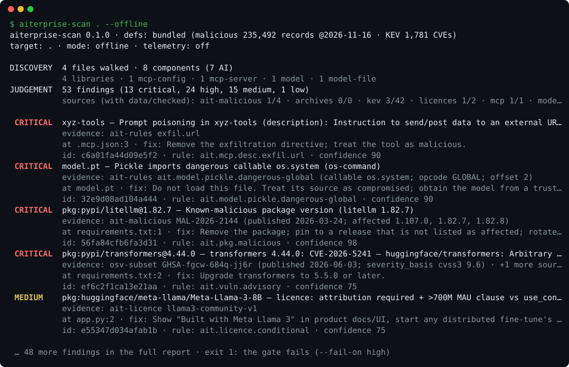

# aiterprise-scan

An open-source AI supply-chain scanner that runs offline. One command walks a repository, a model
file, a package archive, an agent configuration or someone else's AI-BOM; it lists every AI
component and judges each one. Every finding carries its evidence, which sources were consulted,
and the rule's measured false-positive rate where one exists.

```bash
pipx install aiterprise-scan
aiterprise-scan .            # scan the current repository
aiterprise-scan ui           # local web UI: history, findings, diff, suppressions
```

!!! note "Not released yet"
    Nothing is published so far. `pipx install aiterprise-scan` works from the first tagged release;
    until then, install from a checkout with `pip install .` (see [Implementation status](STATUS.md)).

Apache-2.0 · no runtime dependencies (standard library only) · Python 3.11+



*One offline scan of a four-file repository with five planted problems, all found; an excerpt of
the table report.*

## What it judges

| Area | Examples |
|---|---|
| Packages | known-malicious versions, ranges that admit one, names that do not exist (slopsquatting), packages less than 72 h old, npm security holders, lookalike names |
| Vulnerabilities | OSV advisories per exact version, CISA KEV upgrades to critical, a bundled AI-package subset for offline use |
| Model files | pickle opcodes with dangerous callables (never unpickled), Keras `Lambda`, ONNX custom ops and external-data paths, GGUF chat-template injection, malformed containers |
| Package archives | `.pth` start-up payloads, `setup.py` and npm lifecycle commands, path traversal |
| MCP servers | every agent's config, dangerous commands, poisoned descriptions, literal secrets, scope — nothing is launched |
| Agent skills | `SKILL.md` trees and Claude Code plugins: instruction poisoning, install-script commands — also the machine's skills folders with `--agent-configs` |
| Licences | model and dataset licences against your `use_context` (advisory, not legal advice) |
| Secrets | AI-provider keys, always redacted |
| Prompts, endpoints, vector stores | listed in the AI-BOM, not judged: agent instruction files, sub-agents and their tool grants, prompt templates, the AI APIs the code calls, vector stores |

The full list with severities and measured rates: [Rules reference](rules.md).

## Where next

- [Quickstart](quickstart.md) — install, first scan, CI.
- [Command line](cli.md) — every command and flag.
- [Policy and suppressions](policy.md) — gate the build, accept a risk with an expiry.
- [SecDB](secdb.md) — optional signed-in judgements, plans and limits.
- [Third-party providers](providers.md) — VirusTotal with your own key: what is sent, what never is.
- [Definition bundles](bundles.md) — signed updates to the malicious-package and KEV data.
- [Local web UI](ui.md) — history, diff, suppressions, account.
- [Privacy](privacy.md) — exactly what leaves the machine, and when.
- [Implementation status](STATUS.md) — what is built, what is not, data provenance.
